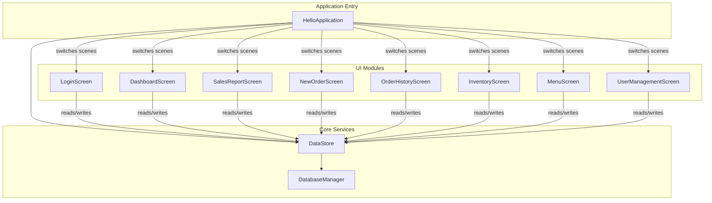
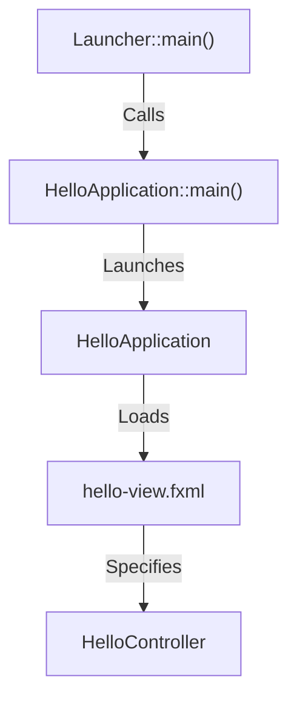
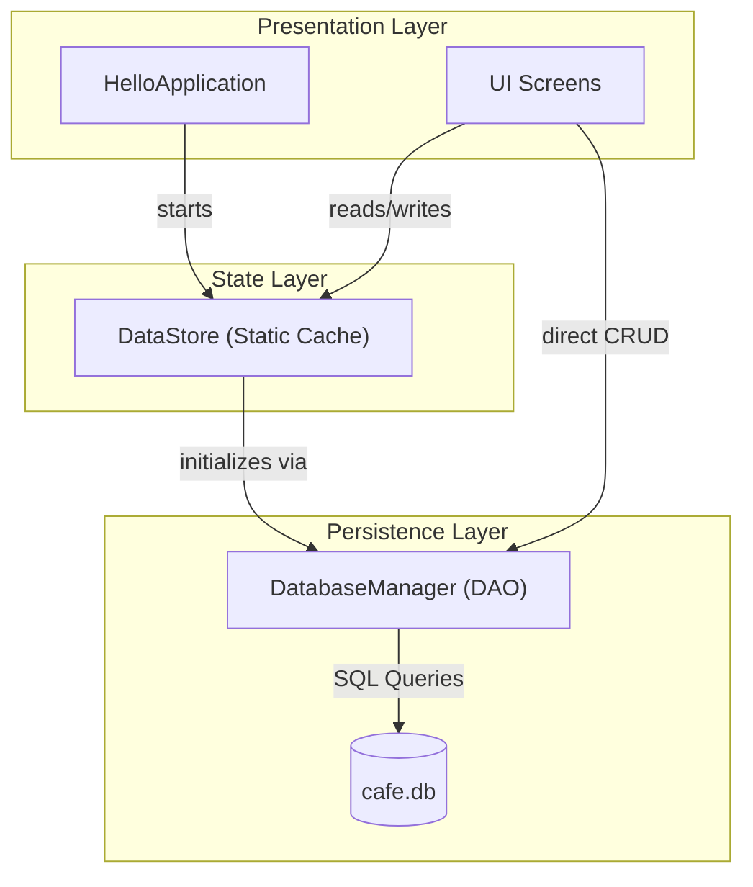
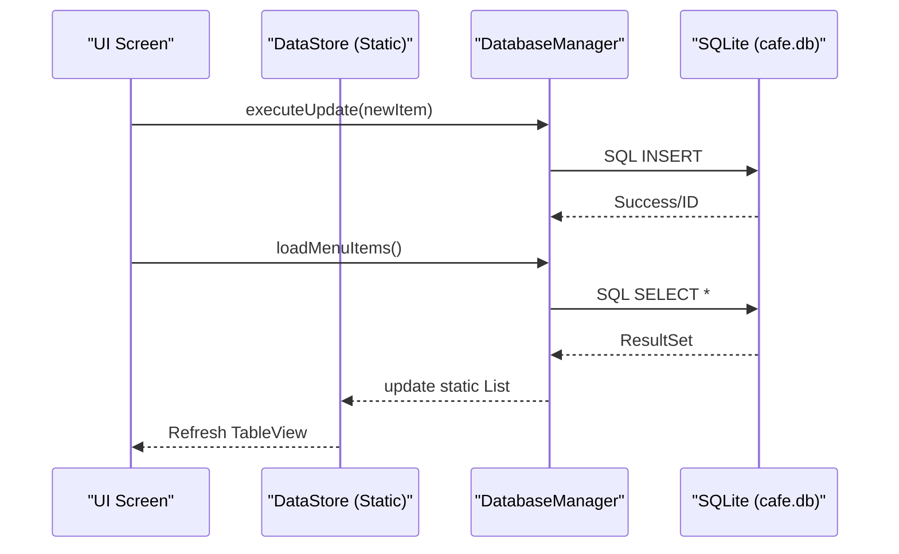
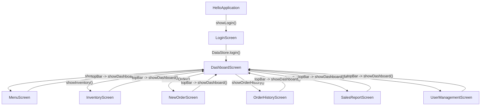
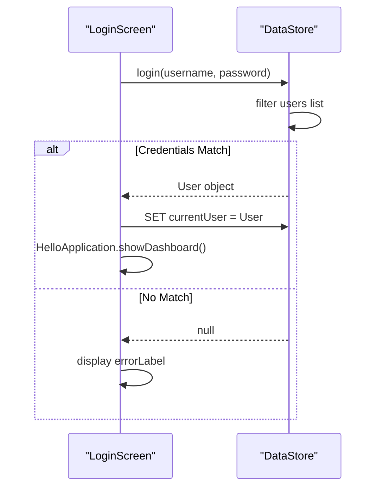
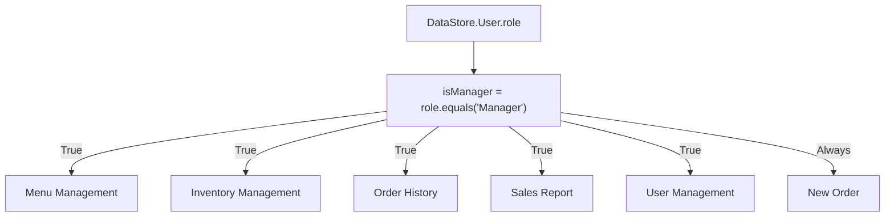

# ByteBrew Cafe Management System

A desktop application designed to streamline cafe operations, including order processing, inventory tracking, menu management, and sales reporting. Built with Java and JavaFX, it provides a centralized platform for both managers and cashiers to manage daily business activities.

---

## Table of Contents

1. [Overview](#overview)
2. [Getting Started](#getting-started)
3. [Project Structure](#project-structure)
4. [Core Architecture](#core-architecture)
5. [User Interface Screens](#user-interface-screens)
6. [Security and Access Control](#security-and-access-control)
7. [Glossary](#glossary)

---

## Overview

The **ByteBrew Cafe Management System** serves as a comprehensive Point of Sale (POS) and Enterprise Resource Planning (ERP) tool for small-to-medium cafes. It automates the calculation of orders (including a 5% tax logic), tracks stock levels in real-time, and generates analytical reports to help management make data-driven decisions.

### Technology Stack

| Technology | Details |
| :--- | :--- |
| **Language** | Java 25 |
| **UI Framework** | JavaFX 21 (Controls & FXML) |
| **Database** | SQLite via JDBC (v3.47.1.0) |
| **Build System** | Maven (with Maven Wrapper) |
| **Testing** | JUnit 5 (Jupiter v5.12.1) |

### User Roles

The system implements Role-Based Access Control (RBAC):

- **Manager** — Full access to all modules, including User Management, Sales Reports, and Inventory/Menu configuration.
- **Cashier** — Restricted access focused on operational tasks such as creating New Orders and viewing Order History.

### Module Map



---

## Getting Started

### Environment Requirements

- **JDK:** Version 25
- **Build System:** Maven 3.8.5+ (or use the included Maven Wrapper — no pre-installed Maven needed)
- **OS:** Cross-platform (Windows, macOS, Linux)

### Build & Run Commands

| Command | Description |
| :--- | :--- |
| `./mvnw clean compile` | Cleans the `target/` directory and compiles source code |
| `./mvnw javafx:run` | Launches the application |
| `./mvnw clean javafx:run` | Recommended: clean, compile, and run in one step |

> On Windows, use `mvnw.cmd` instead of `./mvnw`.

### Database Bootstrap

ByteBrew uses an embedded SQLite database (`cafe.db`). It is **zero-config** — the database is created and seeded automatically on first launch:

1. **Connection** — SQLite creates `cafe.db` if it does not exist.
2. **Schema Creation** — `DatabaseManager` creates five tables: `users`, `menu_items`, `inventory`, `orders`, `order_lines`.
3. **Seed Data** — Default accounts are inserted if the `users` table is empty.

**Default credentials:**

| Username | Password | Role |
| :--- | :--- | :--- |
| `admin` | `admin123` | Manager |

### IDE Setup (IntelliJ IDEA)

- Set the Project SDK to **Java 25**.
- The IDE will auto-detect the Maven project via `pom.xml`.
- Main entry point: `com.cafe.cafemanagementsystem.HelloApplication`

---

## Project Structure

```
CafeManagementSystem/
├── src/
│   ├── main/
│   │   ├── java/
│   │   │   ├── com/cafe/cafemanagementsystem/   # All Java source files
│   │   │   └── module-info.java                 # JPMS module definition
│   │   └── resources/
│   │       └── com/cafe/cafemanagementsystem/   # FXML layout files
├── pom.xml                                       # Maven build config
├── mvnw / mvnw.cmd                               # Maven Wrapper scripts
└── cafe.db                                       # SQLite database (auto-generated)
```

### Java Module System (JPMS)

The module `com.cafe.cafemanagementsystem` in `module-info.java`:

- **Requires:** `javafx.controls`, `javafx.fxml`, `java.sql`
- **Opens:** main package to `javafx.fxml` for reflective FXML controller access
- **Exports:** main package for JavaFX launcher access

### Application Bootstrapping Flow



---

## Core Architecture

ByteBrew follows a layered architectural pattern:

1. **Presentation Layer (JavaFX)** — Manages UI state via a single `primaryStage`.
2. **State Layer (DataStore)** — Centralized static in-memory cache and session manager.
3. **Persistence Layer (DatabaseManager)** — Handles all SQL operations against `cafe.db`.

### Component Interaction



### Data Flow Pattern (Sync-on-Write)

When a user performs an action (e.g., adding a menu item):



### Key Classes

| Class | Role |
| :--- | :--- |
| `HelloApplication` | App entry point; manages `primaryStage` and scene switching |
| `DataStore` | Static in-memory cache; holds users, menu items, inventory, orders, and current session |
| `DatabaseManager` | DAO layer; all SQL DDL/DML operations against `cafe.db` |
| `Launcher` | Non-modular wrapper that calls `HelloApplication.main()` for JAR compatibility |

---

## User Interface Screens

All screens follow a consistent layout: a `VBox` root with a `topBar` for navigation, followed by a workspace (typically a master-detail split with a `TableView` and a side form).

### Screen Navigation Flow



### Screen Descriptions

| Screen | Access | Description |
| :--- | :--- | :--- |
| **LoginScreen** | All | Entry point; authenticates users via `DataStore.login()` |
| **DashboardScreen** | All | Central hub; displays KPI stat cards; enforces RBAC for module visibility |
| **NewOrderScreen** | All | Split-view for selecting menu items and managing a live shopping cart |
| **OrderHistoryScreen** | Manager | Searchable log of all past transactions with receipt reconstruction |
| **MenuScreen** | Manager | Manage cafe offerings; add/edit items with categories (Drink, Food, Dessert) |
| **InventoryScreen** | Manager | Track ingredient stock; rows highlighted red when below low-stock threshold |
| **SalesReportScreen** | Manager | Aggregates revenue data; calculates Top 5 Selling Items via Java Streams |
| **UserManagementScreen** | Manager | Create accounts, assign roles, remove users (self-deletion protected) |

### Global Styling

Color palette defined in `HelloApplication`:

| Name | Hex |
| :--- | :--- |
| Blue | `#1a3a6b` |
| Red | `#c0392b` |
| Green | `#1a7a4a` |

---

## Security and Access Control

### Authentication Flow



### Role-Based Access Control (RBAC)



### Account Protection

- **Self-Deletion Protection:** `UserManagementScreen` compares the selected user against `DataStore.currentUser` and blocks deletion if they match.
- **Password Handling:** Passwords are currently stored as plain text in the `users` table. Input is masked in the UI via `PasswordField`, but no hashing is applied at the persistence layer.

---

## Glossary

| Term | Definition |
| :--- | :--- |
| **Billed** | Default status assigned to an order upon successful persistence |
| **Cashier** | User role with restricted access; limited to creating new orders |
| **Low Stock** | State triggered when an item's quantity is ≤ its defined threshold (`DataStore.InventoryItem.isLowStock()`) |
| **Manager** | Privileged user role with access to all management, reporting, and admin modules |
| **Order Line** | A single entry in an order representing a `MenuItem` and its quantity (`DataStore.OrderLine`) |
| **Stat Card** | Dashboard UI component displaying high-level KPIs (e.g., revenue, low stock count) |
| **DataStore** | Static in-memory cache acting as the application's "Source of Truth" at runtime |
| **DatabaseManager** | DAO class responsible for all SQLite interactions |
| **RBAC** | Role-Based Access Control — access restrictions enforced at the UI layer based on `currentUser.role` |
| **JPMS** | Java Platform Module System — used via `module-info.java` to manage dependencies and encapsulation |
| **Maven Wrapper** | Bundled scripts (`mvnw`/`mvnw.cmd`) that download and run Maven without a system-level install |
